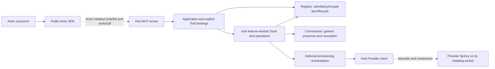

# agentorg: design

The Hub exposes only the Tools composed from its own feature modules. Every open Actor receives
that catalog and initiates its own calls to the Hub. Actor presence means an admitted connection;
it says nothing about a native agent or control endpoint. Provider provisioning is a separate role.

## Components and entry points

AgentOrg's server and clients are separate applications. The server owns the organization;
clients act through its gateway with the identity and authority of an actor. A human, an agent
session and a program are ways of operating an actor, rather than kinds of actor.

| Application | Entry point | Responsibility |
|---|---|---|
| Server | `agentorg-server [--port <n>]` | Run the core. Its `service install`, `service uninstall` and `status` operate only this service. |
| Actor CLI | `agentorg <operation>` | Call the organization's built-ins as an actor. |
| MCP client adapter | `agentorg-mcp [--client <name>]` | Present an actor's operations over stdio. Its `connect`, `disconnect` and `status` own project integrations; `context` and `wait` own client hooks. |

The package distributes these three executables and the public `@agentorg/cli/actor` library.
Their source boundaries are `src/server/` and `src/clients/{cli,mcp}/`. Each application owns
its entry point and setup. Server code imports no client application, and clients import neither
the server nor sibling applications. Clients reach the organization through the actor library.
The shared domain model supplies their types.

`@agentorg/cli/contract` exposes an explicit selection of public wire schemas and types from
`src/domain/model/` and the installed Workspace package; external clients use it to validate and type
requests and responses. `BUILTINS` is the existing derived schema inventory, while feature
modules continue to own runtime operations. Storage records and bound operations stay internal.

The [Human client](https://github.com/uniac-ai/OrgActor-Human) owns its browser UI, local HTTP API,
configuration, launcher and service in a separate repository. It depends on the public Actor library
and Hub contract; browser users depend on its HTTP interface. The Hub has no dependency on that
application or its build, and organizational authority stays in the Hub's domain.

`src/runtime/` contains host mechanics: pinning an executable and its environment in a launcher,
managing one user service, reporting launcher and HTTP availability, and reporting command
errors. It imports no application and performs no organization operation. Executable paths come
from the package's `bin` map. Each service has its own launcher, service name and lifecycle, and
MCP project setup checks its own launcher and the core.

The applications share the actor, credential and attachment contracts described below.

## Layers

The domain defines its storage and Actor-connection ports. Protocol and storage adapters depend on
those contracts; the network supplies bidirectional JSON-RPC transport without domain knowledge.
The server composition root wires the concrete adapters to the domain's clients.

| Layer | Folder | Responsibility |
|---|---|---|
| Network | `src/network/` | Loopback listener, connector and duplex text channels. |
| Connection | `src/connection/` | Admission of an existing Actor or Provider and immutable identity. |
| MCP binding | `src/bindings/mcp/` | Actor client, Hub server, Tool metadata and operation results. Only this binding imports MCP. |
| Provider client | `src/provider/` | Hub's typed factory methods on an admitted Provider connection. |
| Domain | `src/domain/` | Identity, presence, explicit Hub Tools, organization and communication state. |
| Storage | `src/storage/sqlite/` | Domain records through the Store port, using `node:sqlite`. |
| Clients | `src/actor/`, `src/clients/`, external clients | List and invoke the Hub's explicit Tools as an Actor. |

`src/domain/ports.ts` defines Application, ActorConnection, Invocation and Store. An
ActorConnection exposes only revocation. `test/layers.test.ts` checks module boundaries, the
acyclic domain import graph and the domain's independence from Node and protocol libraries.

The module dependencies below lead from consumers to their owners. Dashed arrows show protocol
requests over separately admitted, bidirectional JSON-RPC connections.

Each feature operation owns its authority policy over the admitted Actor and its records.
Generic identity and presence supply no callable Actor interface. The Provider factory path has
its own admitted principal and does not turn the created Actor into an invocation endpoint.

## The domain

`src/domain/index.ts` composes peer state owners and their explicit feature Tools:

| Owner | Responsibility |
|---|---|
| `registry.ts` | Actor identity, hierarchy, credentials and lifecycle authority. |
| `connections.ts` | All admitted Actor connections, presence and revocation. |
| `execution.ts` | One optional Provider provisioning outcome for an already-created Actor. |
| `actors.ts` | Actor lifecycle and public projection, using Registry, Connections and Execution. |
| `team.ts` | Identity, hierarchy, actual admitted connection presence, and each Actor's report as one view. |
| `attention.ts` | The one read that waits: what concerns its caller, and which public records changed. |
| `workspace.ts` | Explicit bindings to package-owned directory, Messages, Work, Forms and Status under the admitted Actor. |
| `claims.ts`, `audit.ts` | Shared resource claims and append-only audit metadata. |
| `tools.ts` | Schema contracts bound to their module-owned typed operations. |
| `capabilities.ts` | Project supplied Hub Tools into public descriptors and private operations. |
| `application.ts` | Validate and invoke those operations as the admitted Actor, enforcing domain refusals and write audit. |

### Tools and interfaces

A Tool is `{id, name, interfaces}`. Each interface contains its local descriptor, a `call` alias,
an optional `read_only` hint and its `level`. `(tool.id, interface.name)` identifies it.
`Actor.available()` returns these Tools; the CLI and MCP adapter's `interfaces` operation return
`{tools: [...]}`.

`level` is the smallest organization level that presents the interface: `report` (one agent and its
person), `team` (working with other Actors) or `organization` (the lifecycle and the system). Each
level contains the one before it. Workspace contracts carry their own tag, which the Hub's
definitions keep; the Hub tags its own Tools. The tag selects what a client presents and grants or
refuses nothing.

Every open Actor receives the same eleven Hub Tools and thirty interfaces:

| Tool | Report | Team | Organization |
|---|---|---|---|
| `actors` | | | `actor_create`, `actor_close` |
| `team` | | `team`, `actor_view` | |
| `directory` | | `actor_get`, `actor_list` | |
| `messages` | | `message_send`, `message_get`, `message_list` | |
| `work` | `work_create`, `work_get`, `work_list`, `work_update`, `work_submit` | `work_review` | |
| `forms` | `form_create`, `form_get`, `form_list`, `form_close` | `form_respond` | |
| `status` | `status_set`, `status_get` | | |
| `claims` | | | `claim`, `release` |
| `attention` | `attention` | | |
| `activity` | | | `activity` |
| `system` | | | `system_status`, `connection_list`, `provider_list`, `connection_disconnect` |

IDs are `hub:<name>`. Discovery and invocation use the same module-owned operations. The caller's
hierarchy and the operation's records govern domain authority; they do not add Tools. Actor IDs,
paths, cached advertisements and guessed aliases cannot introduce callable interfaces. A closed
Actor receives no Tools. `BUILTINS` is a derived schema inventory for CLI and typed consumers,
while feature modules own runtime registration.

### Attention and Actor views

`attention {since?, wait?}` reads the audited writes after `since` and returns what concerns its
caller and was done by someone else:
- `answer`: an answer to its ask;
- `ask`: a new ask from one of its direct reports;
- `assigned`: Work created for it, or reassigned to it by the Work's requester;
- `review_due`: a submission of Work it requested;
- `reviewed`: a review of Work it owns;
- `message`: a Message to it.

Each item names its record, who did it, a title and when. `changed` names the Actors whose status,
and the Work and asks whose records, anyone changed, the caller included, so a view stays current;
Messages appear only as their recipient's items. `next` is the audit position read through; passing it
back as `since` continues without gaps. Without `since` the read returns at once with the current
position. With nothing to return it waits up to `wait` seconds (at most 600): every audited write wakes
waiting reads, which read again. It is a read, not a subscription; callers set a request timeout above
`wait`.

`actor_view {actorID?, completed?}` joins an Actor's report at read time, from the registry,
connections, audit and the Workspace records it can read: the Actor with its presence and last write;
its status; its workstreams (Work it owns that is active, blocked, submitted or has changes requested,
and such Work it requested of its direct reports), each with its open asks linked to it; its other open
asks; its reports' open asks (`needs`); submitted Work it reviews; open Work assigned to it and its own
follow-ups; its latest completed Work; its direct reports; and a name map. Its `state` is derived:
the most urgent of `blocked`, `waiting` (active Work with an open ask), `review` (submitted) and
`active` among its workstreams, else `idle`. Each list holds at most 100 records.

### System observations and connection controls

`system_status` reports the answering Hub's UUID `instanceId`, authoritative `observedAt`, start
time, package/Node versions, admitted socket counts and bounded diagnostics. `serving` means that
this Hub answered. Socket presence and local work counts establish neither native health nor
remote idleness. `provider_list` reports configured identities, admitted connection counts and the
exact selected factory socket. The latest admitted socket is selected; closing it does not promote
an older socket. Configuration and credential hashes remain private.

`connection_list` filters by connection/Actor/Provider ID; `provider_list` filters by Provider ID
and explicit `connected` boolean. Predicates AND before the bounded limit. Pages carry the Hub's
instance and observation time, insertion position `after`, and `atEnd` for that observation.
Continuation requires the matching instance; future positions are invalid. Keep independent
positions per caller and filter, restarting at zero on changes. Current membership may change
between pages, so refresh from zero before reconciling removals. Retained values keep their original
timestamp when a refresh fails.

`connection_disconnect {instanceId,connectionId}` detaches one exact socket with close code 1000.
An active Actor controls its own other sockets, direct reports' sockets, and all Actor sockets when
it is canonical root. Only canonical root controls Provider sockets. The carrying socket is refused
using trusted admission context. The same authority and observed busy/closing guards produce
`canDisconnect` and govern mutation. Write invocations, complete Provider creation sequences
including inter-RPC gaps, and pending factory requests block detach; a read, including a waiting
`attention`, ends with its socket. The inventory marks closing
before dispatch can start new work. Actor lifecycle closure retains revocation code 4001.

`closed:true` means the Hub detached that exact entry and initiated transport close. Clients may
reconnect under new IDs. This action does not establish worker shutdown or completed remote work.
A close or post-effect audit failure can leave an unknown outcome; inspect the exact ID in the same
run and never automatically retry or chase reconnects.

Diagnostics retain at most 100 fixed-code observations in this run, newest first, with explicit
retained/dropped counts. Coverage is admission, MCP/protocol, nonprivate operation failure, Provider
creation failure and admitted transport closure; it is not a complete health history. Records select
only fixed messages/codes/stages/outcomes, known admitted identity/connection, offered nonprivate
operation alias and observed numeric close code. Unadmitted claims and arbitrary error/body/config
data are omitted. `message_send`, `message_get` and `message_list` produce no operation-specific
diagnostic events, including on validation, storage or audit failure. Generic transport facts never
attribute a close to a private operation. Observation failures do not alter business outcomes.

An interface descriptor contains name, optional title/description, input/output JSON Schemas and
generic `one_way`/`long_running` flags. The MCP binding flattens the catalog and carries semantic
identity through `_meta["agentorg/tool"] = {id, name, interface, one_way, long_running, level}`. The
Actor client reconstructs the nested catalog from that metadata. Operation results are `done {value}`
or `refused {code, message}`; they carry no Actor-call receipt or destination.

### Records and storage

An Actor has id, name, path, purpose, manager, online state and creation/closure timestamps.
The durable identity also holds a credential hash that public views omit. Online means at least
one admitted Actor connection; multiple caller connections coexist. Closing an Actor revokes
all its connections while preserving independent Provider connections.

Hub SQLite schema 9 stores canonical Actors, claims, audit metadata and a private Workspace import
ledger. The retired Actor calls stay in their table as private history that no operation reads.
A separate `core.workspace.db` is opened through the installed package's public persistence API. The package owns its schema, transaction rules and record history; Hub
owns both handles and closes them after the listener. Workspace authority receives the admitted
Hub Actor ID on every call. The canonical directory returns active Actors in stable insertion order;
named lookup also resolves closed counterparts. `team` returns only `{root, positions}`, with actual
connection presence on each position.

The package is vendored and bundled into the distributable SDK at an immutable source/checksum
pin in `vendor/workspace.json`. No package MCP server or additional network service is started.
[Workspace storage](workspace-storage.md) describes startup import, retained originals and backups.

Actor handles remain unique among open siblings, and paths describe the organization. Actor and Team metadata contain no callable-interface or native-session fields.

### Record authority

The Hub's Actors Tool creates direct reports and closes leaves under the existing manager/root
lifecycle policy. Shared resource claims remain Hub-owned: a live holder prevents another claim,
expiry or holder closure permits replacement, and a holder or root may release it. `activity`
exposes operation metadata only,
and only to the root: it names every Actor's operations, including who sent each private Message
and when, so every other caller is refused `forbidden`. Its entries come oldest first: the latest
`limit` without `since`, or the earliest `limit` after `since`, so passing the last entry's id as
the next `since` continues a poll without skipping entries.

Workspace modules enforce record roles, equally for human, agent and program clients:

| Record | Authority |
|---|---|
| Message | Immutable P2P correspondence in its pair's conversation, readable only by sender and recipient. `message_send` takes `recipientID` and `text`; replies are new Messages. |
| Work | Every active admitted Actor reads the complete record. The requester sets goal and owner and reviews the exact submission; the current owner edits title, progress, status, links and waits-on, and submits. Work the owner requested itself completes on submit. |
| Form | An ask is its asker's own output and names no respondents. Every active admitted Actor reads it and may answer while it is open, except an `approval` ask, which only the asker's managers up to the root answer. Only the asker resolves or cancels it. |
| Status | One record per Actor: its line, summary and links. Every active Actor reads it; only the Actor itself sets it. |

`work_list`, `form_list` and `message_list` return `{items, next, actors}`; `message_list` adds
`older`. `next` and `older` are opaque positions for the same read and filter, `next` is null when
nothing further matched, and `actors` names the Actors the page mentions. Work and Form lists go in
update order, or newest first with `order: "recent"`, and `updatedSince` keeps records changed at or
after a time. A Message carries its `conversationID` and its `seq`, its place in one order across
every conversation; `message_list` accepts a `seq` as `after`, so a reader resumes from the last
message it handled. The Workspace contracts document every filter.

`requesterWithin` and `ownerWithin` select the named canonical Actor and all descendants through
retained `manager` edges, including closed members and anchors without Team's depth limit. Unknown
IDs match nothing. Hub supplies synchronous `ActorAuthority.within` under the admitted active caller;
the Workspace applies it to filters and to who may answer an approval. Membership adds no write role
or Message access. Message state, history and operations expose no read/handled status. A native
approval requires a client-owned validated binding to its native request and authorization; an
arbitrary Form response is insufficient.

Known package errors map to Hub refusals (`invalid_input` becomes `invalid`). Unexpected errors,
including errors after a package commit or during Hub audit, remain transport errors with unknown
write outcome. Clients must inspect durable state before deciding whether to retry a write.

When execution is requested, the Actors module creates the organizational Actor through Registry
before calling Execution. The execution client uses the selected Provider's configuration schema and
creation interface; `config` is a required JSON object. Its result is
`{providerId, status: "ready" | "failed" | "unknown", error?: {code, message}}`. The returned Actor
view is read after that call, so it includes any connection established while the Provider worked.
The Actor, credential and independently established connection survive a failed or unknown outcome.
Without `execution`, creation returns only the Actor and credential.

`ready` means the Provider returned a valid successful creation reply for execution of the
Hub-owned Actor. Provider owns local execution readiness and protected bootstrap before that reply;
native bookkeeping is its implementation detail. Hub observes the reply; Actor connectivity, MCP
initialization and model activity are separate. Hub sends one creation request, retains no retry
inputs and performs no automatic replay after uncertainty. Native resource management belongs to
the external Provider.

The Hub gives configuration description and execution creation one combined 45-second budget,
within the 60-second default caller budget. Expiry before launch returns `failed` and a late
description cannot start execution. Expiry after launch may have been sent returns `unknown`;
the Hub neither cancels nor replays it. Explicit caller timeouts retain their chosen behavior.

## Actor-to-Hub MCP

Each Actor initiates a WebSocket at `/connection`, sends
`connection.connect({actorId, credential?})`, and receives `{connectionId}`. Admission requires an
existing open identity and matching credential under the default policy. The admitted principal
is immutable. Admission creates no Actor and returns no catalog.

The Actor's MCP client then initializes on that bidirectional JSON-RPC channel and calls the Hub's
MCP server. The Hub publishes its explicit Tools through `tools/list`; `tools/call` invokes one as
the admitted principal. Actors need no MCP server. Their messages cannot register advertisements
or a reverse invocation endpoint. The SDK's `connectClient` requires `url` and `actorId`, with a
credential under the default policy. It lists Tools, calls their interfaces and reconnects after
a transport drop. Generic progress notifications remain part of the transport. A request's caller identity
does not depend on an incoming call, native session or RPC cause.

## The MCP adapter

The MCP adapter, `agentorg-mcp` in `src/clients/mcp/`, is an optional client for Claude Code or Codex. Its local attachment records connect a session to an Actor; the Hub stores no native-session marker. The client starts it over stdio and it calls the Hub through the Actor library. Project integration and hooks belong to this adapter.

- **What the session sees.** The stdio adapter has three fixed MCP tools: `attach`, `interfaces`, and `call {name, input}`. `interfaces` returns `{tools: [...]}` from the attached actor's library, with stable Tool identities, local interface descriptors and their call aliases. `call` invokes an interface using its `call` alias as `name`. The presentation's fixed controls form one semantic `agentorg` Tool, separate from the Hub catalog. Before its first turn, the client's session-start hook runs `agentorg-mcp context`, so a session that fills no position reads that it loads the `agentorg` skill and attaches before any other action. The adapter's instructions say the same.
  - `attach {actor}` fills the position the session's brief names.
  - `attach {name, purpose}`, allowed only on a session's first attach, creates its position directly under the root. The agent actor uses the root's credential for that one call.
  - The MCP controls remain fixed across attachment and resuming. The current Hub catalog is read on each `interfaces` invocation, with no adapter cache. Logical operations such as `team` are invoked as `call {name: "team", input: {}}`.
- **What the session is told.** Each kind of guidance has one place:
  - the adapter's tool descriptions say how to attach, list and invoke; the core's interface descriptors define each operation's description and schemas, and the core enforces permissions;
  - the server's instructions, the start hint and the frame around what the waiter delivers say what to do at that moment;
  - the `agentorg` skill, `skills/agentorg/`, carries the operating model the core can't enforce, such as when to ask rather than decide, at what level to write, and when to delegate and close, with a reference per client. It maps logical operation names through `call` without restating their descriptions;
  - an organization's own conventions are a skill of its own, loaded beside it.
- **Credentials.** The session never sees one.
  - Each position's credential is kept in the agentorg home's credential store, `actors/<id>`, mode 600.
  - When the session's `actor_create` creates a report, the agent actor keeps the report's credential there, and the session gets the result with that credential replaced by a note that it was kept.
  - `actor_close` forgets the closed position's credential.
- **Session identity and resuming.** `sessions/<client>-<session id>/position` names the position a conversation fills. Claude Code names the session in `CLAUDE_CODE_SESSION_ID`. Codex identifies it in each tool call's `_meta.threadId`, carried through the presentation boundary as optional occupant-session context. Initialization and listing need no identity; a Codex call requires one, and the adapter refuses a different identity after binding. The first call recovers only that conversation's saved position. `attach {actor}` acknowledges the same actor; a session cannot change actors. A fork with a new thread id attaches independently.
- **Project hooks.** `connect codex` writes AgentOrg's `SessionStart` context commands to `.codex/hooks.json`, preserving other entries. Launcher command and arguments are edited by their parsed TOML value ranges, preserving surrounding policy and comments. The commands take identity from stdin's `session_id`, not inherited environment variables. Project configuration requires trust, hooks must be enabled with `features.hooks`, and the definitions require review and trust through `/hooks`. Startup, resume and fork identity behavior is verified against the Codex build in use; thread and session-tree identities are not derived from each other.
- **Delivery and waking.** Claude Code's hooks run the waiter, `agentorg-mcp wait`, when the session starts and whenever its turn ends, as `asyncRewake` hooks. Codex's hooks supply context; its sessions read their inbox when they run, since its background hooks do not wake idle turns.
  - The waiter polls incoming `message_list` after its Message position and `form_list {requesterID: self}` for changes to the session's own asks since the last one it delivered, as the ordinary attached Actor, with private positions in `sessions/<session>/inbox`.
  - Each poll reads at most one page per feed. A later invocation continues each feed from its own position.
  - A replaced waiter or stopped client closes its read connection. Individual reads also have a five-second timeout. It writes the records with their canonical sender/requester names and IDs, then atomically replaces its private checkpoint and exits with status 2. Claude Code hands that output to its session as input. No public receipt is written. A write followed by a crash before saving local positions can redeliver the same records.
  - A newer waiter replaces an older one. Generic delivery is at least once; native approval handling belongs to the client.
  - The private checkpoint is `{messages, forms}`: the last delivered Message `seq` and the `updatedAt` of the last delivered ask. An older checkpoint with Form cursors keeps its Message position, which is the same `seq`, and re-reads the session's asks from the start. This can redeliver asks under the at-least-once contract; it reissues no domain write or native request.
  - Existing sessions require deliberate cursor baselining at cutover. Legacy shared cursors cannot be reused as package cursors. The private historical import manifest supports that later client coordination; the Hub does not activate or seed clients.

## The network

- **Opening.** A WebSocket opening error or closure rejects the initial connection and closes its socket.
- **Origin.** Upgrades with an Origin header are refused.
- **Admission.** Identity owners check credentials; the listener admits no identity itself.
- **Reconnect.** The client repeats admission and MCP initialization after a drop. Revocation code 4001 ends reconnection.

## Provider connections

Providers initiate the same `/connection` socket with
`connection.connect({providerId, credential?})`. Exactly one Actor or Provider identity is required;
connecting registers neither. The server administrator enrolls Provider IDs and SHA-256 credential
hashes in private `<home>/providers.json` (mode 600), an array of
`{providerId, credentialHash}`. Missing configuration admits no Providers. Provider credentials and
Actor bootstrap credentials are independent opaque values.

The Hub's internal typed client calls `provider.describe({}) -> {configSchema}` and
`provider.createActor({actorId, credential?, config}) -> {actorId}` on the initiating Provider socket.
Configuration is a required JSON object; the returned Actor ID must match. Provider messages cross
the client boundary as validated results or sanitized errors, with numeric JSON-RPC codes and stable
semantic names in `error.data.code`. A lost creation reply leaves the outcome unknown and sends no
cancellation. The client performs no automatic replay.

The Provider client owns only wire interaction. Hub owns organizational identity, state and authority;
an Actor's identity survives executor replacement. Provider owns native execution management, and
the Actor client initiates its own independent connection to the Hub.
